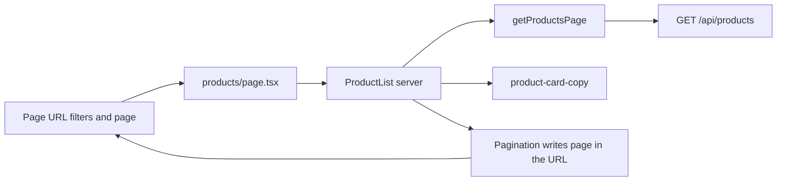

# Products grid on the server

This ticket is the products page grid: read the filter query already in the URL, request `GET /api/products`, paginate, and show the shared product card. Comments about [`config.ts`](src/shared/lib/constants/config.ts), the footer, home wrappers, and the most-popular route stay out of this work.

## Occasion highlight

A selected occasion does not change style because of the comment. [`occasion-list.tsx`](src/features/products/components/products-filters/occasionfilter/occasion-list.tsx) calls `select(el.id)` and then sets `isActive` to `selectedId === el.title`. The id never equals the title, so the active gradient on the overlay never applies. Change that line to `selectedId === el.id`.

[`category-list.tsx`](src/features/products/components/products-filters/CategoryFilters/category-list.tsx) already compares `selectedId === el.id`. Renaming `selectedTitle` in the filter headers does not affect the highlight. Those values only show or hide the reset button.

The products page stays an async Server Component. The list asks the backend through `apiFetch` (`API_URL`). The browser helper in [`api-allProducts.ts`](src/features/products/lib/apis/api-allProducts.ts) hits `/api/products/all-product`, and `next: { revalidate }` does nothing in the browser.



## Server fetch

In [`products.api.ts`](src/shared/lib/apis/products.api.ts), add `getProductsPage` that returns `response.payload` as `IPaginatedPayload<IProduct>` from [`api.d.ts`](src/shared/lib/types/api.d.ts). The item type is `IProduct` from [`product.d.ts`](src/features/products/types/product.d.ts). Keep `getProducts` as `(await getProductsPage(...)).data` so the carousel, most-popular, and overview callers stay `Promise<IProduct[]>`.

The list calls `getProductsPage` with `next: { revalidate: 300 }`. `getProducts` drops `metadata`, and [`Pagination`](src/shared/ui/pagination.tsx) needs `total` and `limit`.

Map the URL names the filters already write to the backend names, skipping empty values:

- `page` to `page`, `limit` to `limit`
- `category` to `categoryId`
- `occasion` to `occasionId`
- `rating` to `minRating`
- `minPrice` and `maxPrice` stay as they are

`Pagination` writes `page` and `limit` onto the current query and leaves the filter keys, so the next page is a new server request.

## List and card

Rewrite [`products-list.tsx`](src/features/products/components/products-list.tsx) as an `async` Server Component. Remove `"use client"`, `useQuery`, and `getAllProducts`. Do not modify [`product-card.tsx`](src/shared/components/product-card.tsx). Render [`product-card-copy.tsx`](src/shared/components/product-card-copy.tsx), which already uses [`AddToCartButton`](src/shared/components/add-to-cart-button.tsx) and [`WishlistButton`](src/features/wishlist/components/wishlist-button.tsx).

Keep the 3-column grid and `NoItemsFound`. Pass `metadata.total` and `metadata.limit` into `Pagination`.

Format the price on that card with two decimal places in [`product-card-compound.tsx`](src/shared/components/product-card-compound.tsx) `Details` (`toFixed(2)` on the discounted price and the original price). [`getDiscountedPrice`](src/shared/lib/utils/price.ts) already branches on `PERCENT` and `FIXED`.

## Loading and errors

Move the existing 12-card skeleton into [`src/features/products/skeletons/products-list.skeleton.tsx`](src/features/products/skeletons/products-list.skeleton.tsx). Wrap the list in `Suspense` on [`products/page.tsx`](<src/app/[locale]/(site)/products/page.tsx>).

Add [`src/app/[locale]/(site)/products/error.tsx`](<src/app/[locale]/(site)/products/error.tsx>) with a failure sentence and a retry button. On the installed Next.js 16.4 version, use its documented `retry()` prop (preferred over `reset()` because it re-fetches and re-renders the segment). Do not import the 404 page. [`src/app/[locale]/error.tsx`](src/app/[locale]/error.tsx) renders `children`, and Next passes none, so it would not show that retry.

## Remove the unused client path

Delete both files. [`api-allProducts.ts`](src/features/products/lib/apis/api-allProducts.ts) is only the browser fetch. [`allProducts.d.ts`](src/features/products/types/allProducts.d.ts) copies shapes that already exist:

- `Product`, `ProductDetails`, and the category, review, and count types are `IProduct` and `IProductOverview` in [`product.d.ts`](src/features/products/types/product.d.ts)
- `ProductsMetadata` is `IMetaData` in [`api.d.ts`](src/shared/lib/types/api.d.ts)
- `AllProductsResponse` is `IPaginatedResponse<IProduct>`

`IProductsMetadata` and `IProductsPayload` in `product.d.ts` repeat `IMetaData` and `IPaginatedPayload<IProduct>`. Replace them with those shared types (`IProductsPayload = IPaginatedPayload<IProduct>`).

The URL filter type is the only shape that is not already there. Add it in `product.d.ts` by extending `IMetaData` for `page` and `limit`, and adding the filter fields the page URL already uses:

```ts
export type IProductListParams = Partial<Pick<IMetaData, "page" | "limit">> & {
  category?: string;
  occasion?: string;
  rating?: number;
  minPrice?: number;
  maxPrice?: number;
};
```

The products page and the list use `IProductListParams` instead of `GetAllProductsParams`. Then delete `allProducts.d.ts`.

Also delete:

- [`use-allProducts.ts`](src/features/products/hooks/use-allProducts.ts)
- [`all-product/route.ts`](src/app/api/products/all-product/route.ts)

The other product routes (`[id]`, `search`, `filters`) stay.
